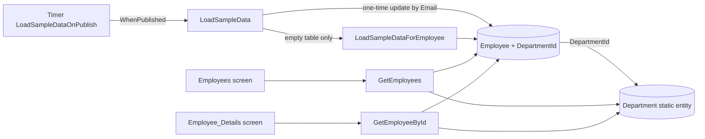

# Design Document
## Overview
This is the design for the add-department change to the existing app EmployeeCatalogMW (asset key 07a64c21-0c8c-8afb-28ee-5d8530d55cf8). It adds a Department to each employee, shows it on the list and detail screens, and lets Staff filter the list by department. It has no custom code.
Requirements approval: the user approved `requirements.md` as written on 2026-11-22, including the Department assignment table and its judgment calls. Nothing in `MentorWeb/.kiro/specs/employee-catalog/` is changed by this design.
Build approach: direct Mentor prompts through the OutSystems MCP, because this changes an existing app. There are two prompts, and each one is its own task, with its own Mentor session and its own publish:
1. Data prompt, then publish 1.
2. Screens prompt, then publish 2.
After the checks pass, the last task updates `MentorWeb/.kiro/specs/employee-catalog/requirements.md` and regenerates the BRD in `MentorWeb/BRD/` (see "Last task" below).
Docs basis: outsystems-docs MCP, source "odc". last_updated 2026-10-28T09:05:12Z, the same sync as the Research notes in requirements.md. Searches run for this design: timers (run in the ODC Portal, validate a timer), Mentor Web data model prompts, delete rule, Mentor Studio aggregate prompts (filter, join) and the dropdown filter example. Two points the docs do not cover: a daily timer limit in the Development stage (not found, so it is taken from the user), and adding a reference attribute to an already published entity (see Research notes, Q2).
Design decisions:
- The Department of the 20 existing employees is set by a one-time update inside the existing sample data logic, because Mentor is not documented to update existing records (Research notes, Q4) and the bootstrap only inserts when the Employee table is empty.
- The update is idempotent. It sets DepartmentId only where it is empty, so the timer can run it any number of times, including the retries the platform does after a timer timeout.
- The update and the department of the sample records run under the same development-stage condition (IsInDevStage) as the existing bootstrap. This is a decision of this design, not of the requirements. If the user wants the update without that condition, say so before prompt 1 is sent.
- The Department column is added as the last column, after Email, and it is not sortable (requirements.md: no other sorting).
- The two Mentor sessions are separate, and every prompt names the real elements and ends with "Do not change anything else." and "Do NOT publish the app in this turn."
## Architecture

## Real names in the published app
Source: the stored graph of revision 6, which is still the latest revision (app_revisions, checked while writing this design), and the context lookups. The graph is saved as `Reports/graphdiff/rev6.txt` (copied from the first build's working folder, byte for byte). Read-only calls only. The requirements call the screens Employee_List and Employee_Detail. The app calls them Employees and Employee_Details. The prompts use the app names.
| Thing | Real name in the app |
|---|---|
| App | EmployeeCatalogMW, revision 6, Reactive Web |
| Entity | Employee (key b30bcb89-4e1d-a920-2479-f109f0559674). Attributes: Id, FirstName, LastName, Email, JobTitle, IsActive, Picture |
| List screen | Employees (key d4751b18-e7c0-d5c3-f518-080b59c35b93), UI flow MainFlow |
| List aggregate | GetEmployees. Source Employee. Filters today: the search on SearchKeyword (FirstName or LastName), IsActive = True, the role check. Sort: TableSort |
| List widgets | Container "Filters" with the Search block (input Input_TextVar), TableRecords "Table" with the columns FirstName, LastName, JobTitle, Email, Pagination block |
| List variables and actions | Variables StartIndex, MaxRecords, SearchKeyword, TableSort. Actions OnSearch (sets StartIndex to 0 and refreshes GetEmployees), OnSort, OnPaginationNavigate |
| Detail screen | Employee_Details (key 045d08ca-ec2d-fb7d-0383-d48b2d3801a7), input parameter EmployeeId |
| Detail aggregate | GetEmployeeById. Filters: Employee.Id = EmployeeId and the role check. No IsActive filter |
| Sample data actions | LoadSampleData (key 20e6daa3-b8d2-712f-15b6-c121a0c6cb2b): checks GetAliceRecord, then DeleteAllEmployees, then GetEmployeeRecords, then calls LoadSampleDataForEmployee. LoadSampleDataForEmployee (key 8feb70a9-45a2-f64b-0d56-11416314e7dc): JSONDeserializeEmployeeList, then CreateEmployee per record. Helper: IsInDevStage |
| Sample data timer | LoadSampleDataOnPublish (key 714bdcab-77b8-0393-1deb-ab1b53d511c1). Schedule WhenPublished, timeout 20 minutes |
| Structure and import | EmployeeStructure, screen ImportData, actions UploadEmployeeExcel and DownloadEmployeeExcel. Not part of this change |
New names this design introduces: static entity Department, attribute Employee.DepartmentId, screen variable SelectedDepartmentId, dropdown DepartmentDropdown, screen action OnDepartmentChange.
Note: the context lookups (context_screens, context_actions, context_entities) show the model of revision 1 and were not reindexed after later publishes (first build, Reports/EmployeeCatalogMW-verification-report.md). The names above were confirmed in the revision 6 graph.
## Components and Interfaces
### Task 1: data prompt (then publish 1)
Prompt 1, sent as one single prompt, with the app key as the only asset reference:
```
In the EmployeeCatalogMW app, make these data changes.
1. Add a static entity named Department with only the default static entity attributes and no others. Give it exactly 4 records, with the labels Engineering, Finance, Human Resources and Sales. Department is a plain lookup list. Do not create a stateflow, state transitions or any status logic for it.
2. Add an attribute DepartmentId to the Employee entity. It is an Identifier and a Foreign Key to the Department static entity, and it is not mandatory. Do not change any other Employee attribute, any attribute length or the Picture attribute.
3. In the sample data bootstrap (server actions LoadSampleData and LoadSampleDataForEmployee, and timer LoadSampleDataOnPublish), add a one-time update that sets Employee.DepartmentId on the 20 existing sample employees. Match each employee by Email to the table below, and set DepartmentId to the Department record with that label. Set DepartmentId only on an Employee whose DepartmentId is empty. Never overwrite a DepartmentId that is already set, and change no other attribute, so that running the update again changes nothing. The update covers all 20 employees, including the 3 with IsActive false (Hugo Brandt, Maya Petrov and Quinn Abara). Add it in LoadSampleData so that it runs on every execution, on every path that reaches the End node, after the existing GetAliceRecord check, the cleanup and the empty-table check and load, under the same IsInDevStage() condition that LoadSampleData already uses. Refer to the Department records through the Department static entity, never by a hard-coded numeric Id. Keep the timer schedule as it is (WhenPublished), and keep the GetAliceRecord check, DeleteAllEmployees and the empty-table check as they are.
4. In LoadSampleDataForEmployee, add the department to the 20 sample records, using the same table, so that when the Employee table is empty and the 20 records are loaded, each record is created with its DepartmentId already set.
Email, Department:
alice.anderson@example.com, Engineering
bruno.castillo@example.com, Engineering
carla.dubois@example.com, Engineering
devon.marsh@example.com, Engineering
elena.novak@example.com, Finance
felix.okafor@example.com, Engineering
grace.lindholm@example.com, Human Resources
hugo.brandt@example.com, Finance
irene.takeda@example.com, Sales
jonas.ferreira@example.com, Sales
kara.whitfield@example.com, Finance
liam.oduya@example.com, Sales
maya.petrov@example.com, Engineering
nolan.reyes@example.com, Engineering
olivia.sandoval@example.com, Human Resources
pavel.hartmann@example.com, Engineering
quinn.abara@example.com, Finance
rosa.lindqvist@example.com, Human Resources
samir.haddad@example.com, Sales
tessa.moreau@example.com, Sales
Do not change anything else: not the other Employee data (names, job titles, emails, IsActive), the EmployeeStructure structure, the ImportData screen, the actions UploadEmployeeExcel and DownloadEmployeeExcel, any other screen, any aggregate or filter, or any role. Do NOT publish the app in this turn.
```
The prompt table is the Department assignment table of requirements.md with the Email added (the emails are the ones in the first build's sample data, Prompts/5.3-fallback-sample-data.md). The totals are Engineering 8, Finance 4, Human Resources 3 and Sales 5 (active only: 7, 2, 3 and 5).
Publish 1: a separate Mentor turn in the same session, with the app key as the only asset reference, after the user confirms. Publish note: "add-department 1: Department static entity, Employee.DepartmentId, one-time department update in LoadSampleData."
The one-time update runs through the timer LoadSampleDataOnPublish when publish 1 deploys, because the timer runs when published. This is an operational point, not a model change:
- The Development stage has a daily timer limit. The docs search found no such limit, so this comes from the user.
- If the timer cannot run, the user opens the ODC Portal (App, Configurations, Timers, LoadSampleDataOnPublish) and clicks Run now. The docs describe running a timer in the ODC Portal. Kiro cannot read the timer state or the data.
- Nothing is changed in the model for this, and no extra publish is made for it.
- Publish 2 also runs the timer when it deploys. If the update did not run after publish 1, it can still run then, within the same limit. The update is safe to run again.
### Task 2: screens prompt (then publish 2)
Task 2 starts only after publish 1 has finished and the revision has been checked. It uses a new Mentor session, which starts from the published revision.
Prompt 2, sent as one single prompt, with the app key as the only asset reference:
```
In the EmployeeCatalogMW app, show the Department on the Employees screen and the Employee_Details screen, and add a Department filter to the Employees screen. The Department static entity and the Employee.DepartmentId attribute already exist.
Employees screen:
1. In the GetEmployees aggregate, add the Department static entity as a source, joined to Employee on Employee.DepartmentId = Department.Id with a With or Without join, so that employees without a Department are still returned.
2. In the Table widget, add a column with the header Department as the last column, after Email. It shows Department.Label of the row. It is not sortable. Keep the four existing columns as they are.
3. Add a local variable SelectedDepartmentId to the screen. Its data type is Department Identifier and its default value is empty (the null identifier).
4. Add a Dropdown named DepartmentDropdown to the existing Filters container, next to the Search block. Bind it to SelectedDepartmentId. Its options are the records of the Department static entity, sorted by Label, with Label as the text and Id as the value. Add a first option with the text "All departments" and an empty value.
5. Add a screen action OnDepartmentChange and run it on the OnChange event of DepartmentDropdown. It sets StartIndex to 0 and refreshes GetEmployees, as OnSearch does.
6. In GetEmployees, add a new, separate filter condition: SelectedDepartmentId is empty, or Employee.DepartmentId = SelectedDepartmentId. Keep the existing search filter on SearchKeyword, the existing IsActive = True filter and the existing role-check filter exactly as they are, so that all of them apply together. An employee without a Department is returned when no department is chosen and is not returned when a department is chosen.
Employee_Details screen:
7. In the GetEmployeeById aggregate, add the Department static entity as a source, joined to Employee on Employee.DepartmentId = Department.Id with a With or Without join. Keep its two existing filters.
8. Show the department on the screen as a field with the label Department and the value Department.Label of the employee, in the same style and group as the other Employee fields. The value is empty when the employee has no Department.
Do not change anything else: not the other columns, the search, the sort, the pagination, the EmployeeStructure structure, the ImportData screen, any other screen, any role or any sample data action. Do NOT publish the app in this turn.
```
Publish 2: a separate Mentor turn in the same session, after the user confirms. Publish note: "add-department 2: Department column and filter on Employees, Department on Employee_Details."
### Before each prompt and publish
- The user confirms each tenant write and each publish (mentorweb.md). Kiro sends nothing before that.
- Before each edit and before each publish, app_revisions is read. If a revision newer than the last saved graph exists (the user published from ODC Studio in the first build, revisions 3 and 5), its graph is saved and compared too, and the baseline for the comparison is that revision.
- The previous run must be terminal before the next turn starts. A publish is never retried. A timed-out or indeterminate publish is checked with publish_status and the publication key before anything else is done.
- After a publish has landed, the Mentor session is closed.
- Each prompt that was sent is saved in `MentorWeb/Prompts/` with its session, run and publish ids, as in the first build.
### Last task: update employee-catalog requirements.md and regenerate the BRD
The last task updates `MentorWeb/.kiro/specs/employee-catalog/requirements.md` and regenerates the BRD in `MentorWeb/BRD/`, as mentorweb.md requires for every later change.
- Sources and limits: this workspace, the outsystems-docs MCP, and the tenant for read-only lookups only. The MCP folder is not read. Nothing on the tenant is touched. SDD Base is read only (steering and vendor standards) and is not changed.
- When it runs: after the check report. If a check in the report failed, the last task does not start until the user decides. The update describes the app as the requirements say it should be, and any disagreement between the app and the requirements is reported, not hidden.
- The update to requirements.md is exactly the list under "Changes to the employee-catalog requirements.md" in this spec's requirements.md:
  - Add Department and DepartmentId to the Glossary.
  - Add Requirements 6 and 7 with AC-07 and AC-08, with the same wording and numbering as in this spec.
  - Add Department to the columns named in AC-01 and to the attributes named in AC-04. AC-01 to AC-06 keep their numbers.
  - Remove "Departments (no Department entity in this version)" from Out of scope.
  - Add Department_Assignment to the sample data.
  - Nothing else in the file changes.
- The BRD: `MentorWeb/BRD/EmployeeCatalogMW-BRD.md` is regenerated from the updated requirements.md in Mentor format, with the same rules as the first BRD (`Prompts/01-generate-brd.md`): follow the mentor-standards steering file in SDD Base and the two vendor standards it names, and check the Mentor requirement document format with the outsystems-docs MCP (search_docs, source "odc"), reporting last_updated.
  - Department is written as a static entity with its 4 records, and Employee gets DepartmentId as an Identifier that is a Foreign Key to Department, not mandatory.
  - The 20 sample records carry their Department from the Department assignment table.
  - The file keeps the "generated, do not edit by hand" line. It is never edited by hand. If it needs a change, requirements.md is changed and the BRD is regenerated.
  - Before it is overwritten, the current BRD is copied to `Reports/scratch/EmployeeCatalogMW-BRD.before-add-department.md`, so the BRD the first build used is not lost.
  - The prompt used for the generation is saved as one file in `MentorWeb/Prompts/`.
- The BRD is not uploaded to Mentor Web and no app is generated from it. EmployeeCatalogMW is not changed by this task.
## Data Models
Department (new static entity):
- Default static entity attributes only, no others.
- Records: Engineering, Finance, Human Resources, Sales.
Employee (changed):
- New attribute DepartmentId: Identifier, Foreign Key to Department, not mandatory.
- All other attributes are unchanged (Id, FirstName, LastName, Email, JobTitle, IsActive, Picture).
Delete Rule of DepartmentId: the prompt does not state one (requirements.md, Q2). It is read from the graph and reported. Departments are static records, so no Department is deleted while the app runs. Kiro does not change it without the user's decision.
Sample data: the Department assignment table in requirements.md gives the Department of each of the 20 employees. The three inactive employees are Maya Petrov (Engineering), Hugo Brandt and Quinn Abara (Finance).
## Error Handling
- A user without the Staff role is handled as before.
- If the timer does not run, every Department cell is empty and the department filter returns no rows. Fix: Run now on the timer in the ODC Portal, then reload the page. No model change.
- Mentor session or run errors: follow the first build's handling. A failed or timed-out turn is retried in the same session with a narrower prompt, never in a new app. A failed publish is not retried.
## Traceability
- AC-07 (department shown): Department column and GetEmployees join (prompt 2, items 1 and 2), Department on Employee_Details (items 7 and 8), the department data (prompt 1, items 1 to 4).
- AC-08 (department filter): SelectedDepartmentId, DepartmentDropdown, OnDepartmentChange and the new filter condition (prompt 2, items 3 to 6).
- AC-01 to AC-06 must still pass: prompt 2 keeps the existing filters, the existing columns and the sort, and prompt 1 keeps the existing sample data.
- The Rules for Department_Filter: no department chosen means no restriction (the first branch of the filter condition). An employee with no Department is shown then and not shown when a department is chosen (With or Without join and the equality test).
## Open points and risks
These come from the Research notes in requirements.md and from the inspection of the app. No AC is changed.
- AC-07 flag: Mentor is not documented to update existing records. The design does not rely on Mentor knowing how. It names the outcome and the rules of the update (by Email, only where empty, idempotent). If Mentor does not build it as written, the fallback is one narrower follow-up prompt in the same session, and manual work in ODC Studio only if that fails.
- AC-08 flag: a dropdown filter together with search and the active-only rule is not documented for Mentor. Prompt 2 states the three filters and says they apply together.
- Q2: adding a reference attribute to an already published entity is not documented for Mentor.
- Static entity risk: the Mentor Web standards say Mentor can generate a stateflow for status-shaped or category-shaped static entities. Prompt 1 says Department has none. The graph comparison reports any stateflow, state or transition elements.
- Join risk: an inner join in GetEmployees or GetEmployeeById would hide employees without a Department. Prompt 2 asks for With or Without. The graph is read to confirm.
- The one-time update cannot be verified from the model alone. The read tools have no data query, so the data is checked in the browser after publish 2.
- The existing development-stage-only condition applies to the update as well (see Design decisions).
- Not changed on purpose, and reported if Mentor changes them anyway: EmployeeStructure, ImportData, UploadEmployeeExcel, DownloadEmployeeExcel. They do not know DepartmentId, so an Excel import creates employees without a Department and an export has no Department column. This is outside the requirements.
## Testing Strategy
Property-based testing does not apply, so there is no Correctness Properties section. Each AC is checked with an example-based test.
### Graph comparison after each publish
- All graphs and comparison files live in `MentorWeb/Reports/graphdiff/`. Nothing is written to /tmp.
- The scripts from the first build are already copied there: `scope.py` (added, changed and removed nodes per container), `diff.py` (counts and details) and `flow.py` (child nodes of one server action). They contain no /tmp paths. The baseline `rev6.txt` is there too.
- After each publish, the full stored graph of the new revision is read with context_graph (no root, all pages) and saved as `Reports/graphdiff/rev<N>.txt`, where N is the revision number. context_graph can lag behind a publish. If it answers graph_pending, it is retried after about a minute.
- It is compared with the previous saved revision (`rev6.txt` for publish 1, the revision of publish 1 for publish 2) with `scope.py` and `diff.py`. The output of each comparison is saved next to the graphs, as `compare-rev<A>-rev<B>.txt`.
- Any change outside the intended scope is reported to the user before the next step. Metadata stamps, regenerated validation messages and layout X/Y shifts are counted and named, not treated as findings (first build: revisions 3 and 5).
Intended scope after publish 1:
- The static entity Department and its 4 records.
- The Employee entity: the new attribute DepartmentId, and the entity actions that follow from the entity change.
- LoadSampleData and LoadSampleDataForEmployee.
- The module EmployeeCatalogMW (stamps).
Intended scope after publish 2:
- The Employees screen: GetEmployees (new source and one new filter condition), the Table (one new column), the Filters container (the dropdown), the new variable and the new action.
- The Employee_Details screen: GetEmployeeById (new source) and one new field.
- The module EmployeeCatalogMW (stamps).
Not in scope in either publish, reported if changed: the existing filters of GetEmployees, OnSearch, OnSort, OnPaginationNavigate, roles and permissions, the timer, ImportData, EmployeeStructure, UploadEmployeeExcel, DownloadEmployeeExcel, the Employee attributes other than DepartmentId, any other screen, and any stateflow elements.
### Checks in the browser after publish 2
No ODC Studio. The user checks at https://your-tenant-dev.outsystems.app/EmployeeCatalogMW as a Staff user and reports what is seen. Kiro does not see the data. Kiro writes the results with the revision number.
- AC-07: scan the 17 rows of Employees against the Department assignment table (the list is paged, 10 rows per page, so 2 pages). Open Alice Anderson (Engineering), Grace Lindholm (Human Resources) and Liam Oduya (Sales) and check the detail screen.
- AC-08: choose Finance, and the table shows only Elena Novak and Kara Whitfield. With Finance chosen, search "Kara" shows only Kara Whitfield. With Finance chosen, search "Alice" shows no rows. Also choose Engineering (7 rows), Human Resources (3 rows) and Sales (5 rows), then "All departments" (17 rows again).
- Departments of the inactive employees: they are hidden from the list, so the user opens Employee_Details with the EmployeeId of each in the address. Hugo Brandt shows Finance, Maya Petrov shows Engineering and Quinn Abara shows Finance. The Ids are not known to Kiro (the read tools have no data query), so the user finds them.
- Re-check of AC-01 to AC-06, short:
  - AC-01: 17 active rows, with the columns FirstName, LastName, JobTitle and Email (and now Department).
  - AC-02: search "Alice" shows Alice Anderson.
  - AC-03: Hugo Brandt, Maya Petrov and Quinn Abara are not in the list.
  - AC-04: open one row from the list and check FirstName, LastName, Email, JobTitle and IsActive.
  - AC-05: search "Hugo" shows no rows.
  - AC-06: 17 rows in the list plus the 3 inactive employees opened by Id (above) make 20 employees. Alice is active.
- Delete Rule of DepartmentId: read from the graph of the last revision (the attribute DepartmentId of the entity Employee), reported, and not changed.
- Not testable in the browser: an employee without a Department (all 20 have one after the update). This part of the Rules for Department_Filter is checked in the graph: the With or Without join and the filter condition.
The result goes into a new report in `MentorWeb/Reports/`, per AC, with the interventions (each prompt, the session and run ids, the publishes) and any scope finding.
