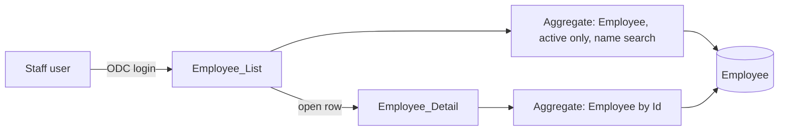

# Design Document

## Overview

Employee Catalog (EmployeeCatalogMW) is a read-only staff directory built as an ODC Reactive Web app. Mentor Web generates it from a BRD that is produced from requirements.md. The design has one local entity (Employee), one role (Staff with View access) and two screens (Employee_List and Employee_Detail). It has no custom code. Any logic Mentor does not produce is first added with a single Mentor prompt sent through Kiro and the OutSystems MCP after generation, and only as a last resort built by hand in ODC Studio.

Docs basis: outsystems-docs MCP, source "odc", synced 2026-10-28 (see Research notes in requirements.md). Docs were not re-queried for this design.

Design decisions:
- Filtering and search run in the screen's Employee aggregate, on the server, because there are only about 20 rows.
- Employee is a normal entity, not a static entity. Sample data is loaded as ordinary records.
- No new scope beyond requirements.md.

## Architecture

- The app uses the standard ODC login. Only users with the Staff role can open the two screens.
- Employee_List is the landing screen. Employee_Detail receives the employee Id as an input parameter.
- All data access is read-only. No create, update or delete actions exist.

## Components and Interfaces

Employee_List:
- A search input bound to a screen variable (SearchText).
- A table with columns FirstName, LastName, JobTitle and Email, one row per record from the list aggregate.
- Each row links to Employee_Detail with the row's Employee Id.
- The list aggregate filters on Employee.IsActive = True.
- When SearchText is not empty, the aggregate also filters on FirstName or LastName containing SearchText.
- When no rows match, the table shows no rows. An empty-state message is optional and is not required by AC-05.

Employee_Detail:
- Input parameter: EmployeeId.
- Shows FirstName, LastName, Email, JobTitle and IsActive of that employee.

Security:
- Role Staff has View access to Employee.
- No other roles.

## Data Models

Employee (local entity):
- Id: auto number, identifier
- FirstName: Text, length 50
- LastName: Text, length 50
- Email: Email, length 250
- JobTitle: Text, length 100
- IsActive: Boolean

No relationships and no other entities.

Sample data:
- 20 fictional Employee records with made-up names and example email addresses on a reserved domain (for example example.com).
- At least 2 records have IsActive = False.
- One active record has FirstName "Alice".
- No real people, phone numbers or addresses.

## Error Handling

- A user without the Staff role is sent to the login or not-allowed page by the standard ODC role check.

## Traceability

- AC-01 (list loads): Employee_List table, list aggregate on Employee.
- AC-02 (search): SearchText input and the name filter in the list aggregate.
- AC-03 (inactive employees hidden): IsActive = True filter in the list aggregate.
- AC-04 (detail screen): Employee_Detail and its row link from Employee_List.
- AC-05 (empty search result): the same filter as AC-02, with zero matches giving zero rows.
- AC-06 (sample data present): the 20 fictional Employee records described under Data Models.

## Open points and risks

These come from the Research notes in requirements.md. No AC is changed.
- AC-02 and AC-05: the docs say search inputs and filters need manual configuration in Mentor Web. Mentor may generate the table without a working search. Fallback: send one separate Mentor prompt through Kiro and the OutSystems MCP, worded exactly as follows:
  "On the Employee_List screen, add a search input bound to a SearchText variable. In the aggregate that loads the Employee records, add a filter so that when SearchText is not empty it returns only the employees whose FirstName or LastName contains SearchText."
  Last resort, only if that prompt fails: add the SearchText input and aggregate filter by hand in ODC Studio.
- AC-03: Mentor Web has no documented way to filter list records by a Boolean such as IsActive. Fallback: send one separate Mentor prompt through Kiro and the OutSystems MCP, worded exactly as follows:
  "In the aggregate that loads the Employee records on the Employee_List screen, add a filter so that it returns only the employees whose IsActive is True."
  Last resort, only if that prompt fails: add the filter by hand in ODC Studio.
- AC-06: the docs do not say Mentor follows record counts or IsActive values from the requirement document. Fallback: send one separate Mentor prompt through Kiro and the OutSystems MCP, worded exactly as follows:
  "Add 20 fictional Employee records with made-up names and example.com email addresses, with FirstName, LastName, Email, JobTitle and IsActive filled in. At least 2 records have IsActive set to False. One active record has FirstName Alice. No real people."
  The docs do not say Mentor can create records this way, so this prompt may fail. Last resort, only if it fails: upload or enter the 20 records so the count, the 2 inactive records and the "Alice" record are correct. Sample data from Mentor Web applies only on the built-in OutSystems domain.
- The verification report in MentorWeb/Reports/ should state, per AC, whether Mentor produced it or manual work was needed.
- Every fallback used, of either kind (a Mentor prompt or manual work), is logged in the verification report as an intervention, with the AC, what was done and the exact prompt or step, because this build is compared with a second build.
- Before a prompt above that names an aggregate (AC-02, AC-05 and AC-03) is sent, the words "the aggregate that loads the Employee records" are replaced with the real aggregate name found during the read-only inspection of the generated app. The AC-06 prompt names no aggregate.

## Testing Strategy

Property-based testing does not apply, so there is no Correctness Properties section. The app is a read-only list and detail UI over one entity with no data transformation logic. Each AC is checked with an example-based test.

- AC-01: open Employee_List as Staff and compare the rows with the active records.
- AC-02: enter "Alice" and check that only matching active rows remain.
- AC-03: check that the records with IsActive = False never appear.
- AC-04: open a row and compare the five attributes on Employee_Detail.
- AC-05: enter text that matches no name and check that zero rows show.
- AC-06: inspect the data for 20 records, at least 2 inactive, one active "Alice", all fictional.

This is a manual check in the first build. Playwright tests in e2e/ are not part of this design.
